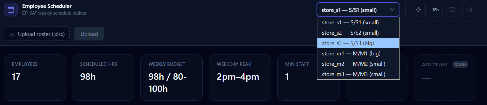
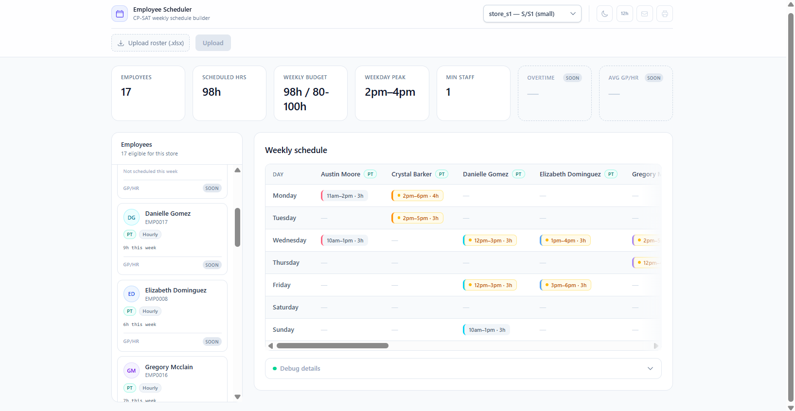
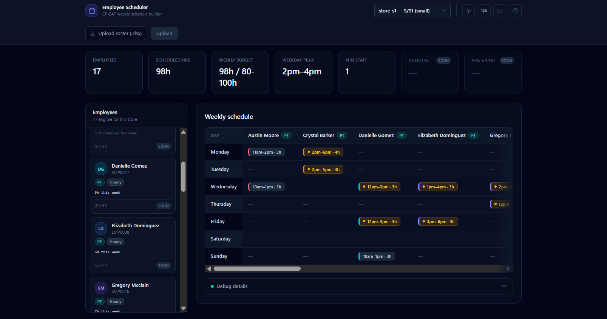
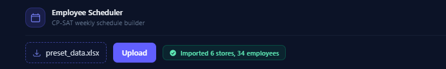
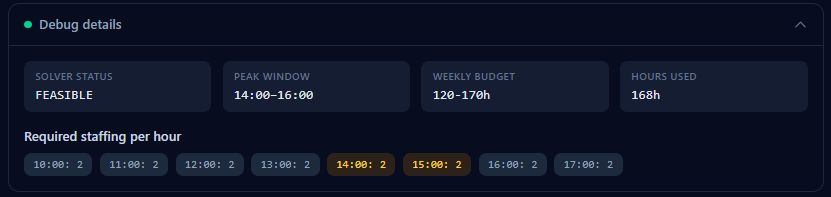
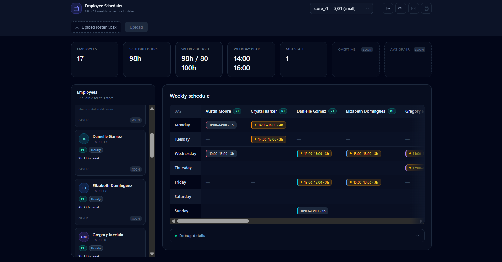
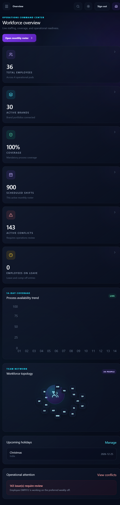
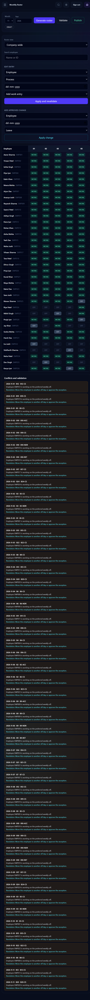
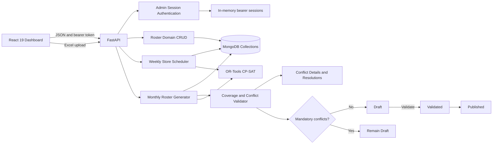
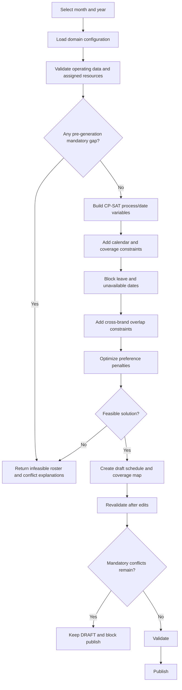

# Smart Roster Management System

**Intelligent Workforce Scheduling and Operations Management**

[](https://www.python.org/)
[](https://fastapi.tiangolo.com/)
[](https://react.dev/)
[](https://vite.dev/)
[](https://www.mongodb.com/)
[](https://developers.google.com/optimization)
[](LICENSE)

Repository: [miteshlohar2005/employee-scheduler](https://github.com/miteshlohar2005/employee-scheduler)

Smart Roster Management System is a full-stack operations and workforce planning application for a company that manages customer-experience processes across multiple brands. It combines configurable monthly roster generation, CP-SAT scheduling, leave and availability workflows, structured conflict detection, roster validation and publishing, CRUD management, and an enterprise dashboard.

The application is local-first and is not currently documented as publicly deployed. A public live demo URL is therefore not included.

---

## Table of Contents

- [Project Overview](#project-overview)
- [Key Features](#key-features)
- [Product Screenshots](#product-screenshots)
- [Technology Stack](#technology-stack)
- [System Architecture](#system-architecture)
- [How the Scheduling Engine Works](#how-the-scheduling-engine-works)
- [Data Model](#data-model)
- [Getting Started](#getting-started)
- [Environment Configuration](#environment-configuration)
- [API Documentation](#api-documentation)
- [Demo Dataset](#demo-dataset)
- [Real-World Conflict Scenario](#real-world-conflict-scenario)
- [Testing and Quality](#testing-and-quality)
- [Deployment](#deployment)
- [Datastraw Engineering Decisions](#datastraw-engineering-decisions)
- [Project Structure](#project-structure)
- [Future Improvements](#future-improvements)
- [Credits and Attribution](#credits-and-attribution)
- [Author](#author)

---

## Project Overview

Workforce operations become difficult to manage manually when one team supports several brands, several processes, different operating calendars, public holidays, planned leave, comp-offs, employee preferences, and minimum staffing requirements. A weekly-off decision or a leave approval can create coverage gaps across several brands.

Datastraw Roster OS provides a central operational record and a deterministic scheduling workflow that:

- allocates employees to configured brand/process assignments;
- separates mandatory coverage constraints from employee preferences;
- identifies uncovered, insufficient, overlapping, unavailable, and preference conflicts;
- lets managers edit an existing draft and revalidate its impact;
- prevents publication until the current roster is validated and conflict-free; and
- preserves the original weekly store scheduling system alongside the monthly operations roster.

Typical use cases include support operations planning, process-specific coverage management, monthly workforce rosters, approved leave processing, manager review, and conflict resolution.

## Key Features

- **Monthly roster generation** with month and year selection.
- **OR-Tools CP-SAT scheduling** for process coverage and employee assignment.
- **Mandatory and preferred constraints** represented separately.
- **Multi-brand, multi-process allocation** for single-resource and multi-resource brands.
- **Pod, pod-lead, employee, brand, process, holiday, assignment, leave, comp-off, and availability CRUD**.
- **Five roster views:** company, pod, brand, process, and employee.
- **Employee-by-day calendar** with work, off, leave, comp-off, holiday, unavailable, and weekly-off states.
- **Structured conflict detection** with date, employee, brand, process, explanation, severity, and resolution guidance.
- **Manual entry and assignment editing** followed by revalidation.
- **Draft, validated, and published workflow** that blocks publishing with unresolved mandatory conflicts.
- **Interactive overview dashboard** with real roster and domain metrics.
- **Administrator bearer authentication** for mutation, management, publish, delete, and upload operations.
- **Legacy weekly CP-SAT store scheduler** preserved and exposed as a separate navigation section.

## Product Screenshots

The repository contains verified screenshots of the original store-focused employee scheduler in `docs/screenshots/`. These document the preserved weekly scheduler rather than the newer roster dashboard.

| Existing screenshot | Description |
|---|---|
|  | Store selection interface |
|  | Original light dashboard |
|  | Original dark dashboard |
|  | Excel upload confirmation |
|  | Weekly scheduling diagnostics |
|  | 24-hour time format |

Additional real screenshots captured from the current application:

| Current application screenshot | Description |
|---|---|
|  | Workforce overview dashboard |
|  | Monthly roster interface |

Conflict Center, Employee Management, and Leave & Availability screenshots should be captured before final submission. No live-deployment screenshot is included because the application is not currently deployed.

## Technology Stack

### Frontend

- React 19
- Vite 8
- Tailwind CSS 4
- Framer Motion
- Lucide React
- Recharts
- Native Fetch API

### Backend

- Python 3.11
- FastAPI
- Uvicorn
- Pydantic-powered request/response handling
- Python bearer-session authentication in the application security module

### Database

- MongoDB
- PyMongo
- Persistent Docker MongoDB volume when using Docker Compose

### Scheduling

- Google OR-Tools CP-SAT
- Deterministic monthly feasibility and coverage solver
- Existing hourly/weekly store scheduling solver
- pandas/openpyxl for Excel import

### Testing and Quality

- pytest
- FastAPI TestClient
- httpx2
- Oxlint
- Vite production build

### Deployment Packaging

- Docker backend image
- Docker frontend/nginx image
- Docker Compose with MongoDB

## System Architecture



The FastAPI application is additive: it preserves the existing store, employee, Excel, and weekly scheduler collections/endpoints while introducing separate `roster_*` collections for the monthly operations system.

## How the Scheduling Engine Works

### Inputs

- Pods and pod leads
- Brands
- Processes and process operating calendars
- Employee employment type and weekly-off preference
- Employee/process assignments
- Public holidays
- Employee leave, comp-off, and unavailable dates
- Minimum staffing requirements

### Hard mandatory constraints

- A process operates only on its configured calendar.
- 365-day processes operate including holidays.
- Weekday processes operate Monday through Friday.
- Sunday/holiday-off processes exclude Sundays and public holidays.
- Minimum process staffing must be met.
- Leave, comp-off, and explicitly unavailable dates cannot be scheduled.
- No employee is assigned to overlapping responsibilities across different brands on the same date.
- Assigned coverage is revalidated after roster edits.

### Soft preferences

- Preferred employee weekly-off dates
- Preferred morning shift assignment

The CP-SAT objective penalizes work on preferred weekly-off dates and can prefer morning availability, but preferences cannot override mandatory process coverage.

### Solver workflow



Generated and edited rosters retain explicit state. Publishing requires `validated` status, a feasible result, no publish-blocking conflicts, and a successful final revalidation.

## Data Model

| Entity | Important fields | Relationships |
|---|---|---|
| Employee | `employee_id`, `name`, `pod_id`, employment type, weekly off, leave, comp-off, availability, preferences | belongs to one pod; assigned to brands/processes |
| Pod | `pod_id`, name, `lead_employee_id` | owns employees and identifies an operations pod lead |
| Brand | `brand_id`, name, active status | owns processes |
| Process | `process_id`, `brand_id`, name, calendar, minimum staffing | belongs to one brand |
| Assignment | employee, brand, and process IDs | links an employee to a process |
| Holiday | date, name, scope | applies to process calendar rules |
| Monthly roster | year, month, status, publish state, coverage, schedule, employee schedule, conflicts | stored by year/month |

MongoDB collections used by the monthly system:

- `roster_pods`
- `roster_brands`
- `roster_processes`
- `roster_employees`
- `roster_assignments`
- `roster_holidays`
- `roster_months`

The preserved legacy collections are `stores` and `employees`.

### Single-resource and multi-resource brands

For single-resource brands, one employee is assigned to all configured processes. For multi-resource brands, two or three employees usually handle separate processes, with optional overlapping process assignments for realistic shared coverage.

## Getting Started

### Prerequisites

- Python 3.11 or later
- Node.js 20 or later
- npm
- MongoDB local instance or MongoDB Atlas
- Windows PowerShell, macOS, or Linux

### Clone

```powershell
git clone https://github.com/miteshlohar2005/employee-scheduler.git
cd employee-scheduler
```

### Backend setup

Windows PowerShell:

```powershell
python -m venv venv
.\venv\Scripts\Activate.ps1
python -m pip install --upgrade pip
pip install -r requirements.txt
```

macOS/Linux:

```bash
python3 -m venv venv
source venv/bin/activate
python -m pip install --upgrade pip
pip install -r requirements.txt
```

### Environment file

```powershell
Copy-Item .env.example .env
```

macOS/Linux:

```bash
cp .env.example .env
```

Set `MONGO_URI`, `MONGO_DB_NAME`, `ADMIN_USERNAME`, `ADMIN_PASSWORD`, and `CORS_ORIGINS` in `.env`. See [Environment Configuration](#environment-configuration).

### MongoDB and seed data

With MongoDB running locally:

```powershell
python -m db.seed_data
python -m db.roster_seed
```

- `db.seed_data` seeds the original store and employee collections from the preset Excel workbook.
- `db.roster_seed` seeds the additive monthly roster domain and does not delete the original `stores` or `employees` collections.

### Start the backend

```powershell
python -m uvicorn api.main:app --reload --host 127.0.0.1 --port 8000
```

API root: [http://127.0.0.1:8000](http://127.0.0.1:8000)

Swagger: [http://127.0.0.1:8000/docs](http://127.0.0.1:8000/docs)

### Start the frontend

```powershell
cd frontend
npm install
npm run dev
```

Open [http://127.0.0.1:5173](http://127.0.0.1:5173).

### Administrator authentication

1. Open **Admin sign in** in the application header.
2. Enter the `ADMIN_USERNAME` and `ADMIN_PASSWORD` configured in `.env`.
3. Use the authenticated session for generation, validation, publishing, CRUD, leave changes, assignment edits, and Excel upload operations.

Bearer tokens are demo/in-memory sessions and expire after eight hours. The backend process restart clears active sessions.

## Environment Configuration

The repository contains:

- [.env.example](.env.example) for Python/backend settings.
- [frontend/.env.example](frontend/.env.example) for frontend build settings.

| Variable | Required | Purpose |
|---|---|---|
| `MONGO_URI` | Yes | MongoDB connection URI |
| `MONGO_DB_NAME` | Yes | Database name |
| `ADMIN_USERNAME` | Yes | Admin login username |
| `ADMIN_PASSWORD` | Yes | Strong admin password for local/demo authentication |
| `CORS_ORIGINS` | Yes | Exact comma-separated frontend origins |
| `VITE_API_BASE_URL` | Frontend build/deployment | Public or local FastAPI base URL |

Do not commit a real `.env` file or database credential. Use a strong unique password locally and a managed identity provider or secret store in production.

## API Documentation

FastAPI exposes interactive Swagger and ReDoc documentation:

- Swagger: [http://127.0.0.1:8000/docs](http://127.0.0.1:8000/docs)
- ReDoc: [http://127.0.0.1:8000/redoc](http://127.0.0.1:8000/redoc)

### Authentication

```http
POST /auth/login
Content-Type: application/json

{
  "username": "admin",
  "password": "replace-with-your-local-password"
}
```

Successful response:

```json
{
  "access_token": "sample-token",
  "token_type": "bearer"
}
```

Send the token on mutation requests:

```http
Authorization: Bearer <access_token>
```

### Roster and validation

| Method | Endpoint | Purpose |
|---|---|---|
| `GET` | `/roster/domain` | List pods, brands, processes, employees, assignments, and holidays |
| `POST` | `/roster/generate` | Generate a monthly draft |
| `GET` | `/roster/{year}/{month}` | Retrieve a generated monthly roster |
| `GET` | `/roster/{year}/{month}/view/{view}` | Retrieve company, pod, brand, process, or employee view |
| `POST` | `/roster/{year}/{month}/validate` | Revalidate and update draft state |
| `POST` | `/roster/{year}/{month}/publish` | Publish only after validation and mandatory checks |
| `POST` | `/roster/{year}/{month}/leave` | Add leave, comp-off, or unavailable status |
| `DELETE` | `/roster/{year}/{month}/leave` | Remove leave, comp-off, or unavailable status |
| `PUT` | `/roster/{year}/{month}/entry` | Add or remove a roster work entry |
| `PUT` | `/roster/{year}/{month}/assignment` | Change a roster assignment |

Example generation request:

```http
POST /roster/generate
Authorization: Bearer <access_token>
Content-Type: application/json

{
  "year": 2026,
  "month": 11
}
```

Example publish block:

```json
{
  "detail": {
    "message": "Cannot publish a roster with unresolved mandatory conflicts.",
    "publish_status": "draft",
    "mandatory_conflict_count": 1,
    "conflicts": [
      {
        "type": "leave_conflict",
        "severity": "critical",
        "date": "2026-11-10",
        "brand_id": "B1",
        "process_id": "B1-CS",
        "employee_id": "EMP001",
        "constraint": "mandatory"
      }
    ]
  }
}
```

### Management and legacy endpoints

| Purpose | Routes |
|---|---|
| Employees | `POST/PUT/DELETE /management/employees/{employee_id}` |
| Brands | `POST/PUT/DELETE /management/brands/{brand_id}` |
| Processes | `POST/PUT/DELETE /management/processes/{process_id}` |
| Pods | `POST/PUT/DELETE /management/pods/{pod_id}` |
| Assignments | `POST/PUT/DELETE /management/assignments` |
| Holidays | `POST/PUT/DELETE /management/holidays/{holiday_date}` |
| Excel/store upload | `POST /upload` |
| Legacy stores | `GET /stores` |
| Legacy weekly schedule | `GET /schedule/{store_id}` |

`POST`, `PUT`, and `DELETE` mutation routes require bearer authentication. Read-only store/domain endpoints remain public.

## Demo Dataset

The additive monthly seed contains:

- 36 employees
- 30 brands
- 4 operational pods
- 24 single-resource brands
- 6 multi-resource brands
- Exactly 80% single-resource brand distribution
- 41 process records
- 47 employee/process assignment records
- Multiple 365-day, weekday, and Sunday/holiday-off process calendars
- Configured public holidays
- Sample leave, comp-off, and unavailable dates

The roster employee names are fictional demonstration data.

## Real-World Conflict Scenario

The tested leave-change workflow is:

1. Generate the November 2026 monthly roster.
2. Add approved leave for `EMP001` on `2026-11-10`.
3. Revalidate the roster.
4. The validator identifies `EMP001` and `B1-CS` on the affected date.
5. The conflict is classified as mandatory and critical.
6. The resolution suggests assigning an eligible backup employee or updating employee availability.
7. Publishing is blocked and the roster remains `draft`.

Critical or mandatory conflicts block publication. Preference warnings, such as a preferred weekly-off violation, are reported separately and do not automatically invalidate the entire roster.

## Testing and Quality

Backend tests cover monthly generation, leave and availability changes, coverage gaps, sample-data distribution, calendar rules, overlapping assignments, publish restrictions, CRUD/API behavior, structured publish errors, authentication, and compatibility with the existing weekly scheduler.

Run the suite:

```powershell
venv\Scripts\python.exe -m pytest tests/test_monthly_roster.py tests/test_phase3_api.py tests/test_scheduler.py -q
```

Other platforms:

```bash
python -m pytest tests/test_monthly_roster.py tests/test_phase3_api.py tests/test_scheduler.py -q
```

Frontend:

```powershell
cd frontend
npm run lint
npm run build
```

Verified current results:

- Backend: 14 tests passing
- Frontend lint: passing
- Frontend production build: passing

## Deployment

The repository includes Docker packaging:

- `Dockerfile.backend`
- `Dockerfile.frontend`
- `docker-compose.yml`
- `docs/DEPLOYMENT.md`

Local Docker preview:

```powershell
docker compose up --build
```

Docker Compose exposes the frontend on port `8080`, the backend on port `8000`, and MongoDB through a persistent named volume.

Before public deployment:

- replace in-memory admin sessions with OAuth/OIDC or another production identity provider;
- set exact public CORS origins;
- use HTTPS;
- store secrets in a secrets manager;
- configure MongoDB backups and monitoring;
- seed persistent MongoDB once;
- set `VITE_API_BASE_URL` to the public FastAPI URL.

No public deployment URL is claimed in this repository.

## Datastraw Engineering Decisions

### 1. How did you model employees, brands, processes, pods, and their relationships?

The domain uses MongoDB documents for pods, brands, processes, roster employees, assignments, holidays, and monthly rosters. A pod contains employees through `pod_id`. A brand owns processes through `brand_id`. Assignments connect an employee to a specific brand/process pair. Leave, comp-off, availability, employment type, and weekly-off preference are employee fields.

### 2. How does the system generate a roster and determine whether it satisfies constraints?

It validates the month and domain, identifies processes that operate on each date, builds boolean CP-SAT variables for eligible employee/process assignments, applies coverage and availability constraints, adds an overlap constraint across brands, and solves for feasibility. The validation engine then rechecks stored assignments, leave, availability, and process staffing.

### 3. How did you handle single-resource and multi-resource brands?

Single-resource brands assign one employee to all of that brand's processes. Multi-resource brands distribute two or three employees across processes and can represent overlapping process ownership. Coverage is enforced per process and date, not merely at brand level.

### 4. What happens when an employee manages all processes for a brand but is unavailable?

The employee is blocked for the leave or unavailable date. Process assignment validation identifies every affected process/brand/date and returns a critical leave conflict with a backup-assignment or availability-resolution recommendation. Publishing remains blocked.

### 5. How does the system handle conflicting requirements or insufficient staffing?

Mandatory conflicts include uncovered processes, insufficient staffing, employee overlap, leave, and unavailable assignments. Each conflict contains date, employee/process/brand context, severity, explanation, and a resolution suggestion. Preference conflicts such as weekly-off violations are separate warnings. The publication workflow rejects mandatory conflicts.

### 6. What process work is automated and what remains under human control?

Automated work includes generation, hard coverage constraints, leave blocking, overlap checks, calendar handling, revalidation, and publish blocking. Humans approve leave, configure resources/calendars, edit assignments and work entries, resolve operational exceptions, and publish validated rosters.

### 7. If the company doubled its team and brand count, what would change?

The next architecture stage should add MongoDB indexes, pagination and virtualized calendars, background roster jobs, tenant boundaries, persistent role-based identity, audit/version tables, solver worker isolation, and larger-data solver performance controls.

### 8. If there were one additional week, what would be improved first?

The first improvements would be backup-employee recommendations, complete audit history, role-based authorization, alternative roster comparison, notifications, Excel/CSV export, and automated browser regression coverage.

## Project Structure

```text
employee-scheduler/
├── api/
│   ├── main.py
│   └── security.py
├── config/
│   └── settings.py
├── data/
│   ├── generate_preset_data.py
│   └── preset_data.xlsx
├── db/
│   ├── connection.py
│   ├── excel_import.py
│   ├── roster_repositories.py
│   ├── roster_seed.py
│   └── seed_data.py
├── docs/
│   ├── APPROACH_NOTE.md
│   ├── DEMO_SCRIPT.md
│   ├── DEPLOYMENT.md
│   ├── SUBMISSION_EMAIL.md
│   ├── USER_STORIES.md
│   └── screenshots/
├── frontend/
│   ├── src/
│   │   ├── components/
│   │   ├── App.jsx
│   │   ├── api.js
│   │   └── index.css
│   ├── .env.example
│   └── package.json
├── models/
│   ├── employee.py
│   ├── roster_domain.py
│   └── store.py
├── scheduler/
│   ├── generate_schedule.py
│   ├── monthly_roster.py
│   ├── peak_hours.py
│   └── staffing_rules.py
├── tests/
│   ├── test_monthly_roster.py
│   ├── test_phase3_api.py
│   └── test_scheduler.py
├── Dockerfile.backend
├── Dockerfile.frontend
├── docker-compose.yml
├── LICENSE
├── NOTICE
└── requirements.txt
```

## Future Improvements

- Production OAuth/OIDC and role-based authorization
- Pod-lead and operations-manager approval workflows
- Persistent audit history and roster version comparison
- Alternative-plan comparison
- Automatic backup-resource recommendations
- Email and in-app notifications
- CSV/Excel export
- Multi-user concurrent-edit locking
- Server pagination and virtualized monthly calendars
- Automated browser end-to-end testing

## Credits and Attribution

This project extends an employee/store scheduling application using FastAPI, MongoDB, React, and OR-Tools. The existing Excel import, peak-hour detection, CP-SAT weekly store scheduler, and original store UI components are part of the starter implementation and remain preserved as a separate legacy workflow.

Monthly roster management, dynamic organization data, CRUD workflows, conflict validation, premium dashboard UI, authentication integration, Docker packaging, and assessment documentation are project extensions.

Third-party technologies retain their respective licenses. Attribution is maintained in [NOTICE](NOTICE), and the project license is available in [LICENSE](LICENSE).

## Author

**Mitesh Lohar**

Final-Year Computer Engineering Student
Full Stack Development and AI Engineering

- GitHub: [https://github.com/miteshlohar2005](https://github.com/miteshlohar2005)
- Repository: [https://github.com/miteshlohar2005/employee-scheduler](https://github.com/miteshlohar2005/employee-scheduler)
